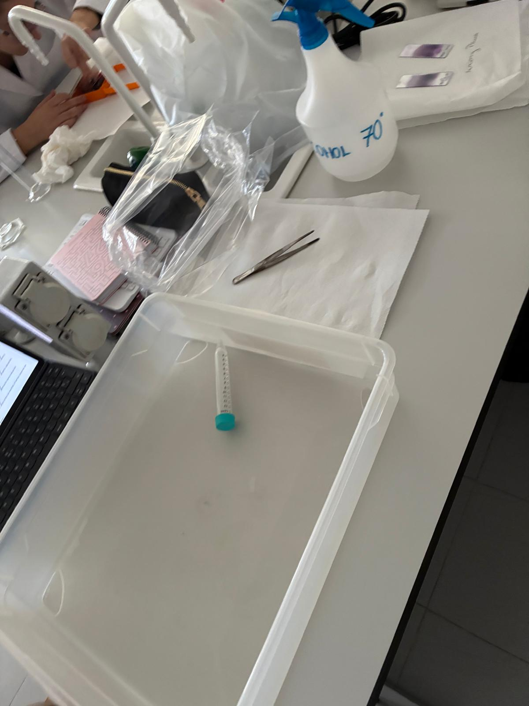
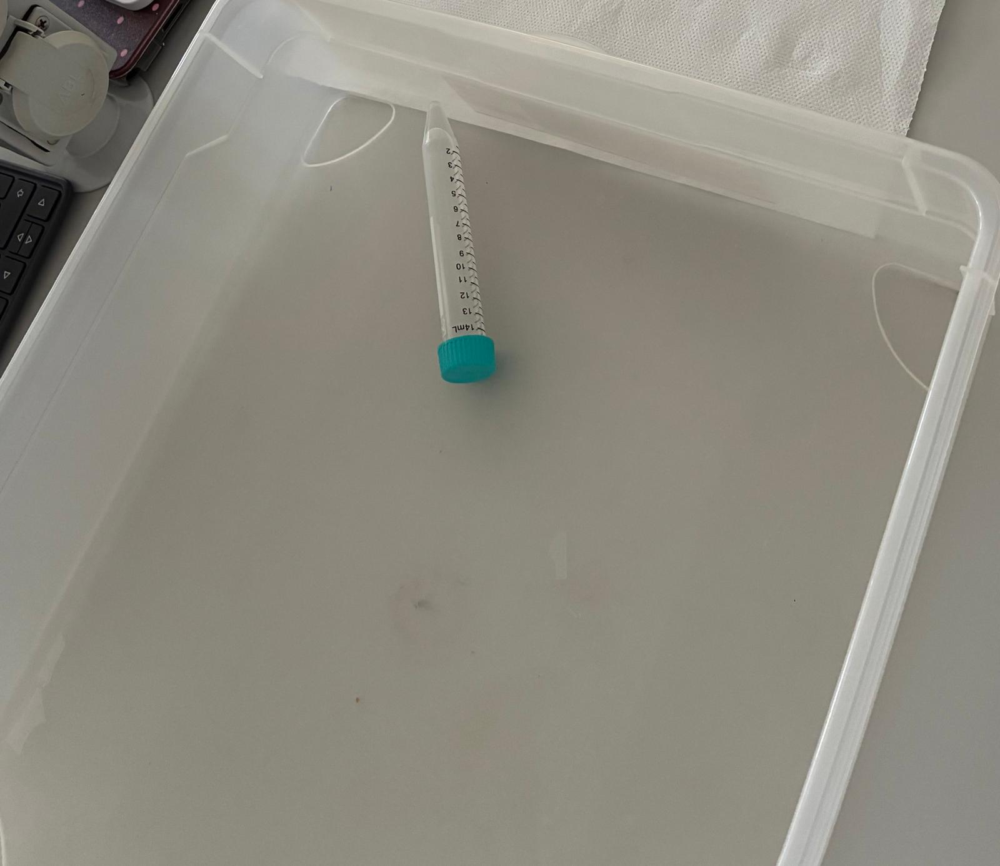
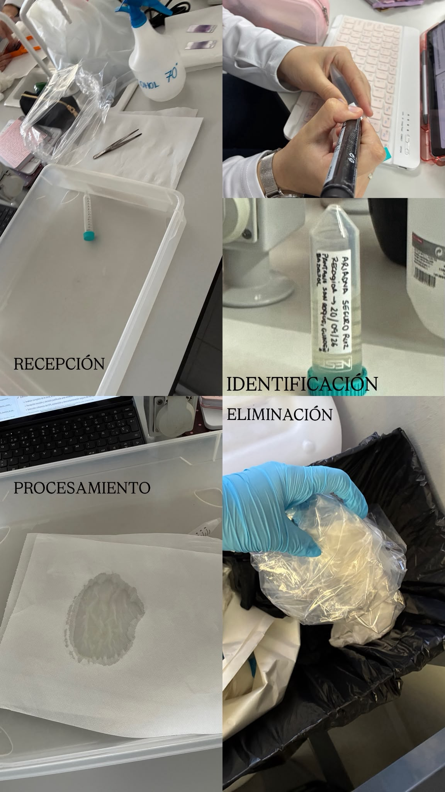
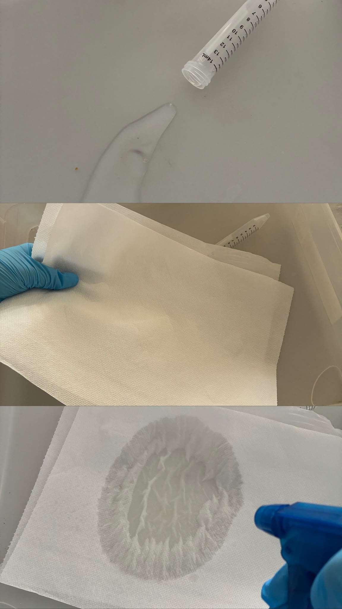
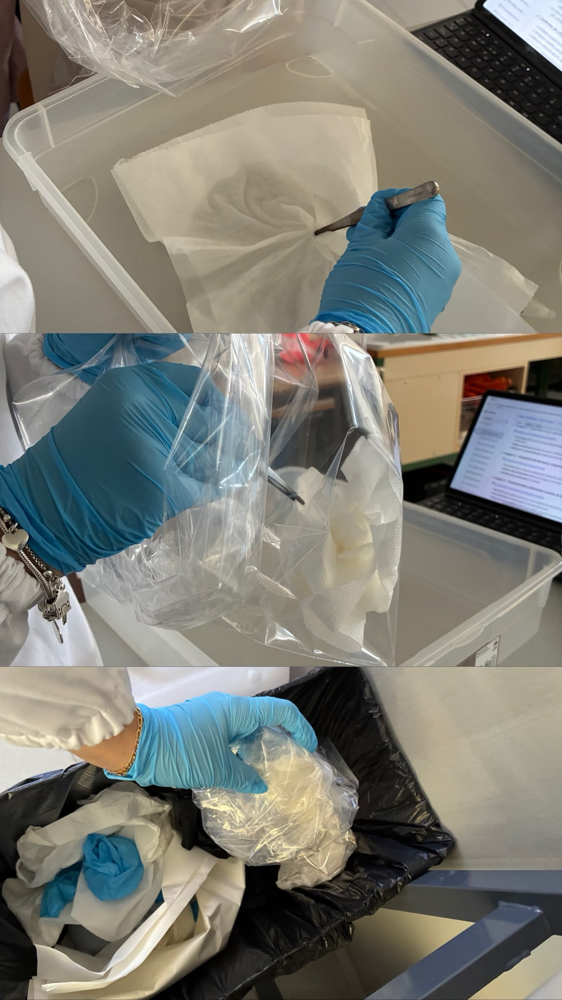

# P01 — Inducción de bioseguridad, riesgos, EPI, residuos y trazabilidad

> **Estado de esta página:** Completa individualmente los bloques **[ALUMNADO · RELLENABLE]** durante o después de la práctica. Si trabajas en pareja, puedes compartir las imágenes del proceso, pero tu registro, interpretación y reflexión deben ser personales.

## 1. Identificación de la práctica

| Campo | Información |
|---|---|
| Código y título | `P01 — Inducción de bioseguridad, riesgos, EPI, residuos y trazabilidad` |
| Unidad didáctica | `UD1 — La microbiología` |
| Resultado de aprendizaje | `RA01` |
| Criterios de evaluación | `CE01.a–CE01.i` |
| Modalidad prevista | Recepción simulada de una muestra líquida, simulación controlada de derrame y resolución individual del registro. |
| Modalidad de seguridad | La modalidad ordinaria utiliza simulante líquido no biológico y material limpio; no se manipulan muestras clínicas ni cultivos salvo autorización expresa del centro y procedimiento validado específico. |

## 2. Resumen

En esta práctica aprenderás a recibir una muestra líquida de forma segura y trazable y a responder ante un derrame simulado. Analizarás el espacio de recepción, la señalización y los peligros antes de seleccionar barreras y EPI. Con una muestra no biológica revisarás la documentación, la identificación, la integridad del envase y el acondicionamiento antes de aceptarla o aislarla. Después provocarás un derrame controlado y aplicarás la respuesta prevista: detener la actividad, señalizar, comunicar, contener, descontaminar y gestionar los residuos. Registrarás las decisiones, los tiempos y las desviaciones. El resultado será un circuito documentado que conecte recepción, incidente, eliminación y trazabilidad. La modalidad ordinaria no usa muestras clínicas ni cultivos; cualquier excepción requiere autorización expresa del centro y un PNT validado.

## 3. Finalidad y resultados esperados

Esta práctica convierte la bioseguridad en un desempeño previo obligatorio, no en un contenido únicamente teórico. Al terminarla deberás poder:

- analizar el espacio de recepción, su señalización y sus condiciones de seguridad;
- identificar peligros y fuentes potenciales de contaminación;
- seleccionar correctamente las barreras y los equipos de protección individual (EPI);
- recibir una muestra líquida simulada y comprobar su documentación, identificación e integridad;
- responder ante un derrame simulado sin generar exposición ni contaminación secundaria;
- segregar, procesar y eliminar los residuos por la ruta autorizada; y
- registrar las decisiones, las incidencias y la trazabilidad de toda la actuación.

## 4. Recursos, riesgos y condiciones de ejecución

**Recursos previstos:** zona de recepción señalizada, simulante líquido no biológico en recipiente primario estanco, envío secundario hermético, solicitud y etiquetas simuladas, bandeja de contención, recipiente secundario de reserva y material de transferencia para el cambio opcional de envase. Kit de derrames: EPI apropiado, absorbente, desinfectante validado, pinzas o recogedor, bolsa o recipiente para residuos, señalización y, si hay punzantes simulados, contenedor rígido resistente a perforaciones. Si no se dispone de kit preparado, se reunirán estos componentes antes de empezar.

**Riesgos que se trabajan:** aceptación de una muestra mal identificada o con fugas, salpicaduras, contaminación de superficies, generación de aerosoles durante un derrame, contacto con desinfectantes y segregación incorrecta de residuos.

**Condiciones de ejecución:** se usará un simulante líquido no biológico, preferentemente coloreado, y material limpio. Se reproducirán de forma realista la recepción, la trazabilidad y las decisiones ante incidencias, sin datos personales ni agentes biológicos. No se manipularán muestras clínicas ni cultivos salvo autorización expresa del centro, procedimiento validado y supervisión. La transferencia de envase será opcional y requerirá autorización docente y zona de contención; la actividad se detendrá ante condiciones imprevistas.

**Medidas generales:** seguir el procedimiento normalizado de trabajo (PNT) del centro, mantener el puesto despejado, separar la documentación de la muestra, usar el EPI indicado, aplicar higiene de manos y respetar el circuito de residuos comunicado por el centro.

**PNT de referencia alternativo:** si el centro no dispone de documentación de referencia validada para la recepción, conservación, descontaminación y gestión de residuos, se tomará como referencia el [Manual de bioseguridad en el laboratorio, cuarta edición, de la OMS (descarga directa del PDF)](https://iris.who.int/bitstream/handle/10665/365600/9789240059306-spa.pdf?sequence=1). Sus indicaciones deberán adaptarse a las instalaciones, los recursos y las normas vigentes del centro; no sustituyen la autorización local.

> **Aviso de seguridad.** La recepción y el derrame se simulan con material no biológico. Los protocolos internos de bioseguridad, residuos e incidencias deben estar validados por el centro antes de aplicarlos como procedimiento real. Esta página no sustituye esos protocolos ni autoriza la manipulación de muestras clínicas.

## 5. Secuencia prevista y criterios de calidad

### Secuencia general

1. Analizar el espacio de trabajo y su señalización.
2. Identificar peligros y fuentes potenciales de contaminación.
3. Seleccionar barreras y EPI adecuados.
4. Llevar a cabo la recepción de la muestra de manera correcta, según el PNT aplicable.
5. Simular un incidente por derrame de la muestra líquida.
6. Resolver la simulación del incidente de manera correcta y segura.
7. Segregar, procesar y eliminar correctamente los residuos propuestos.
8. Registrar la actuación y las decisiones tomadas.

### Procedimientos específicos

**[PNT](https://iris.who.int/bitstream/handle/10665/365600/9789240059306-spa.pdf?sequence=1) de referencia:** [OMS, Manual de bioseguridad en el laboratorio, cuarta edición](https://iris.who.int/bitstream/handle/10665/365600/9789240059306-spa.pdf?sequence=1). Para la descontaminación, consulta también la [monografía complementaria de la OMS sobre descontaminación y gestión de desechos](https://iris.who.int/bitstream/handle/10665/374887/9789240059504-spa.pdf?sequence=1). Si existe un PNT local validado, prevalece sobre estas referencias.

#### Procedimiento 1 — Recogida del envío, recepción y registro de la muestra

1. Confirma la modalidad: la simulación usa simulante y datos ficticios; material real requiere autorización expresa, PNT validado y supervisión. No registres identificadores personales.
2. Prepara la zona señalizada; comprueba iluminación, bandeja, recipiente secundario, desinfectante aprobado, residuos y material de contención.
3. Colócate el EPI previsto para el ejercicio y verifica su integridad; añade protección ocular o facial si la evaluación del riesgo simulado lo requiere.
4. Recoge el envío por su recipiente secundario cerrado, manteniéndolo estable y separado de documentos, material limpio y zonas de paso.
5. Inspecciona el exterior sin abrir: comprueba cierre, integridad, humedad, manchas, fugas y correspondencia entre la identificación del envío y la solicitud.
6. Si el embalaje está dañado o presenta fugas, no lo abras; introdúcelo en el sobreenvase hermético, restringe el acceso y avisa al docente y al responsable.
7. Registra la incidencia simulada y comunica el defecto al remitente ficticio; en una recepción real, se seguiría el circuito de notificación del centro.
8. Si el embalaje está íntegro, abre el recipiente secundario en la zona indicada, con cuidado y sin movimientos bruscos ni salpicaduras.
9. Separa la solicitud del recipiente; protégela y comprueba que no esté contaminada. Registra solo los datos necesarios y nunca identificadores personales.
10. Inspecciona el recipiente primario cerrado; verifica integridad, ausencia de contaminación exterior, etiqueta legible y concordancia con la solicitud.
11. Decide aceptar, aislar o rechazar según los criterios entregados; si no existen, no improvises: registra su ausencia como error o riesgo y detén la aceptación hasta recibir indicación docente.
12. Si el ejercicio lo requiere, transfiere el simulante a un envase compatible en la zona de contención designada; una muestra real requiere autorización expresa, PNT validado y contención apropiada.
13. Conserva identificación y trazabilidad durante la transferencia; en muestras reales, cambia el envase solo con procedimiento local validado y contención apropiada.
14. Cierra el registro, coloca el recipiente aceptado en el envase secundario previsto, ordena la zona, retira el EPI y realiza higiene de manos.

#### Procedimiento 2 — Respuesta ante un derrame simulado

1. En el simulacro, confirma que el simulante es no biológico y que la bandeja está estable; material real exige autorización expresa, PNT validado y supervisión.
2. Comprueba que está disponible el kit; si falta, prepáralo con los componentes enumerados en Recursos. Revisa con el docente el escenario pequeño o hipotético de alto riesgo.
3. Vierte únicamente el simulante dentro de la bandeja, con un recipiente irrompible y sin salpicar, pulverizar ni generar aerosoles deliberadamente; nunca provoques un derrame real.
4. Detén la actividad, avisa a las personas cercanas y no toques, pises, barras ni seques el líquido.
5. Desde una posición segura, valora extensión, ubicación, material implicado, presencia hipotética de aerosoles, objetos cortantes y personas expuestas.
6. Si el escenario representa gran volumen, aerosoles o agente de alto riesgo, simula la evacuación inmediata y restringe el acceso; no inicies la limpieza.
7. Señaliza la zona y comunica el incidente al supervisor y al responsable de bioseguridad, indicando ubicación, material y posibles exposiciones.
8. Representa la respuesta ante una posible exposición: asistencia inmediata y derivación para evaluación médica según el plan de emergencia, sin exponer realmente a nadie.
9. En el escenario de alto riesgo, espera la autorización del responsable antes de reentrar; el tiempo depende de ventilación y protocolo, no de un plazo universal.
10. Para el derrame pequeño contenido, limpia solo tras confirmar el escenario, con el EPI indicado y siguiendo las instrucciones del docente y del centro.
11. Cubre el líquido suavemente con absorbente, sin presionar ni salpicar; evita extenderlo fuera de la bandeja.
12. Aplica el desinfectante aprobado desde el perímetro hacia el centro y respeta la concentración y el tiempo de contacto validados por el centro.
13. Recoge el absorbente con pinzas o útiles; separa los residuos y usa un contenedor rígido únicamente si el escenario incluye punzantes simulados.
14. Descontamina la zona y los útiles reutilizables según el procedimiento indicado, segrega residuos, retira el EPI, realiza higiene de manos y registra decisiones e incidencias.

### Controles de calidad

- Análisis completo de la zona, la señalización y los peligros.
- Recepción trazable y decisión justificada ante envases conformes o irregulares.
- Selección coherente del EPI, contención y descontaminación segura del derrame.
- Segregación, procesamiento y eliminación correctos según la ruta autorizada.
- Registro completo, claro y trazable.

---

# Tu cuaderno de prácticas

## 6. Datos de realización [ALUMNADO · RELLENABLE · DURANTE]

- **Nombre y apellidos:** Ariadna Seguro Ruiz
- **Fecha real de realización:** 28/10/2026
- **Grupo:** 2 LCB
- **Pareja o equipo, si procede:** Trabajo individual
- **Rol o tarea principal que realizaste:** Práctica completa
- **Modalidad realmente realizada:** Simulación con material limpio
- **Tipo de muestra o simulante utilizado:** Muestra ambiental autorizada.
- **Código o identificación de la muestra:** Tubo Falcon 50 ml; Agua recogida del pantano San Roque, Guareña, Badajoz.

## 7. Preparación del puesto y análisis inicial [ALUMNADO · RELLENABLE · DURANTE]

### 7.1 Observación del espacio

Describe brevemente cómo estaba organizado el puesto, qué señalización observaste y qué elementos consideraste relevantes para trabajar con seguridad.

​El puesto de trabajo se encontraba limpio, despejado y dotado de iluminación adecuada. Se visualizó una zona de recepción señalizada, tomas de corriente protegidas, bandejas de contención y elementos de protección como pulverizadores con desinfectante y material estéril. La documentación se mantuvo separada de la zona directa de manipulación de líquidos.

### 7.2 Riesgos identificados

| Riesgo o fuente de contaminación | Consecuencia posible | Medida preventiva seleccionada |
|---|---|---|
| Aceptación de envases con fugas o mal cerrados | Exposición cutánea, salpicaduras y contaminación de superficies de trabajo | Inspección visual previa sin abrir e introducción en sobre envase hermético si hay defectos |
| Generación de aerosoles o salpicadura durante la manipulación o derrame simulado | Inhalación o contacto con agentes simulados o superficies circundantes | Uso de bata, guantes, manipulación cuidadosa sin movimientos bruscos y eso de bandejas de contención |
| Segregación incorrecta de residuos generados en el proceso | Contaminación cruzada y gestión inadecuada de desechos del laboratorio | Respetar estrictamente el circuito de residuos comunicado por el centro y utilizar contenedores diferenciados. |

### 7.3 EPI y barreras seleccionados

| Elemento | ¿Se utilizó? | Justificación técnica |
|---|---|---|
| Bata u otra prenda de protección | Sí | Para evitar el contacto de posibles salpicaduras accidentales con la opa de calle y la piel de los brazos y torso |
| Guantes | Sí | Guantes de nitrilo azules para crear una barrera directa frente al simulante líquido y proteger durante el manejo de material y recipientes. |
| Protección ocular o facial | No aplicaba | a evaluación del riesgo simulado determinó bajo riesgos de proyección directa a ojos, manteniendo la precaución en a manipulación |
| Higiene de manos | Sí, antes y después de realizar la practica | Realizada estrictamente antes de colocar los EPI y al finalizar la práctica tras retirar los guantes |
| Otra barrera o medida | Sí | Uso de bandejas de contención y superficie de trabajo limpia y despejada para delimitar el área de riesgo |

## 9. Controles y resultados [ALUMNADO · RELLENABLE · DURANTE]

### 9.1 Comprobación de los controles de calidad

| Control o criterio | Evidencia observada | ¿Resultado válido? | Justificación |
|---|---|---|---|
| Zona y señalización analizadas | Puesto señalizado, ordenado y con disponibilidad de bandejas y desinfectantes | Sí | Se verificaron las condiciones de seguridad antes de iniciar la manipulación del simulante |
| Recepción e identificación trazables | Recipiente secundario íntegro, etiqueta legible y concordancia con la solicitud simulada | Sí | Permitió aceptar la muestra de forma segura registrando los datos necesarios sin vulnerar la privacidad |
| Derrame contenido y descontaminado | Simulado de forma controlada dentro de la bandeja, uso de absorbente y desinfectante aprobad | Sí | Se evitó la expansión del líquido y se aplicaron los protocolos de limpieza establecidos |
| Residuos procesados y eliminados correctamente | Segregación de materiales utilizados en los contenedores designados por el centro | Sí | Cumplimiento estricto de la ruta autorizada de eliminación de residuos |
| Registro y comunicación final | Cuaderno de prácticas completado con los tiempos, decisiones e incidencias simuladas | Sí | Se garantizó la trazabilidad documental completa de todo el ejercicio |

### 9.2 Resultado principal de la práctica

Resume qué demuestran tus evidencias sobre tu capacidad para analizar la recepción, aceptar o aislar una muestra, responder a un derrame, gestionar residuos y documentar una actuación segura.

​Las evidencias demuestran la capacidad efectiva para analizar un espacio de recepción de muestras, verificar la integridad y trazabilidad de envases no biológicos mediante la aplicación de barreras y EPI adecuados, así como responder de manera segura y controlada ante un derrame simulado y su posterior gestión de residuos sin riesgos para el operario ni el entorno.

## 10. Evidencias visuales [ALUMNADO · RELLENABLE · DURANTE Y DESPUÉS]

> Sube imágenes propias y pertinentes. No incluyas rostros, datos personales, documentación sensible ni material cuya fotografía esté prohibida por el centro. Si la imagen procede de una simulación, de material docente o de una fuente externa autorizada, indícalo expresamente. Una imagen no sustituye la explicación técnica.

### Imagen 1 — Preparación o selección de EPI

- **Pie de foto:** Preparación y manipulación de la muestra en el laboratorio con guantes azules y bata, utilizando pipetas y portaobjetos junto al área de trabajo conectada.
- **Autoría y origen:** Propia.
- **Momento del procedimiento:** Colocación y verificación del EPI (bata y guantes de nitrilo) antes de iniciar la manipulación y recepción de la muestra.
  
### Imagen 2 — Recepción correcta de la muestra

- **Pie de foto:** Visualización microscópica de la muestra que muestra estructuras microesféricas y una fibra alargada sobre el campo óptico.
- **Comprobación técnica asociada:** [Explica por qué la recepción es conforme o por qué la muestra se aislaría]
- **Momento del procedimiento:** Inspección exterior del recipiente secundario y primario, comprobación de la etiqueta, integridad y correspondencia con la solicitud.

### Imagen 3 — Workflow o ciclo habitual de una muestra

- **Pie de figura:** Esquema del workflow o ciclo habitual de una muestra que representa de forma secuencial las fases principales del proceso: recepción del envío, identificación del recipiente, procesamiento y análisis, y almacenamiento o eliminación final de los residuos.
- **Origen y autorización:** Esquema propio.
- **Relación con el procedimiento:** Procedimiento 1, secuencia general.

### Imagen 4 — Simulación del derrame y respuesta inicial

- **Pie de foto:** Microfotografías ópticas del análisis de elementos presentes en la muestra, detallando fibras y pequeños agregados cristalinos.
- **Medida crítica demostrada:** [Explica qué riesgo se controla]
- **Momento del procedimiento:** Simulación controlada del derrame del simulante dentro de la bandeja, interrupción de la actividad y valoración visual de la extensión desde una posición segura.

### Imagen 5 — Procesamiento y eliminación correcta de la muestra

- **Pie de foto:** Eliminación correcta del vertido.
- **Ruta autorizada:** [Completa según el protocolo del centro]
- **Relación con la trazabilidad:** Recogida del absorbente con útiles, descontaminación de la zona, retirada segura del EPI, higiene de manos y segregación de residuos en los contenedores autorizados.

## 11. Incidencias, errores y medidas correctoras [ALUMNADO · RELLENABLE · DURANTE]

| Incidencia, error o duda detectada | Posible causa | Medida correctora aplicada o propuesta | ¿Afectó al resultado? |
|---|---|---|---|
| No se detectaron incidencias críticas durante la simulación de recepción | Manipulación metódica y seguimiento estricto del PNT | Verificación previa de cierres y etiquetas antes de abrir el envase secundario | No, el proceso se desarrolló con total normalidad. |

## 12. Interpretación técnica [ALUMNADO · RELLENABLE · DESPUÉS]

Interpreta los resultados de la práctica. Relaciona el análisis de la zona, la recepción de la muestra, el EPI seleccionado, la respuesta al derrame y el procesamiento de residuos. Justifica tus decisiones con el PNT del centro o, si no existe, con el manual de la OMS enlazado en el apartado 4.

La práctica permitió comprobar que la bioseguridad en el laboratorio no se limita a normas teóricas, sino que exige un procedimiento secuencial riguroso. El análisis previo de la zona y la selección correcta de los EPI (como se observa en las imágenes de manipulación con guantes y bata) son esenciales para prevenir exposiciones accidentales. La recepción de la muestra requiere verificar la correspondencia documental y la integridad del embalaje secundario y primario antes de proceder a su análisis al microscopio o centrifugación. Asimismo, ante situaciones imprevistas como un derrame, la actuación protocolizada *detener la actividad, contener, aplicar desinfectante de perimetraje a centro y gestionar los residuos de forma segregada* garantiza la seguridad biológica y ambiental del laboratorio.

## 13. Conclusión [ALUMNADO · RELLENABLE · DESPUÉS]

Indica si alcanzaste el objetivo de la práctica y qué evidencias concretas lo demuestran. Menciona también alguna limitación de la simulación o de la actividad realizada.

Se alcanzó con éxito el objetivo de la práctica, evidenciado mediante el registro correcto de la trazabilidad de la muestra líquida simulada, la correcta ejecución de los procedimientos de manipulación y el control de derrames. La principal limitación consistió en el uso de un simulante no biológico y material limpio, lo cual, aunque idóneo para la inducción formativa y el desarrollo seguro de las competencias iniciales, no reproduce totalmente la carga de riesgo biológico real de muestras clínicas complejas, las cuales requerirían niveles superiores de contención.

## 14. Reflexión profesional [ALUMNADO · RELLENABLE · DESPUÉS]

Responde de forma razonada a las cuatro preguntas. Relaciona cada respuesta con datos, observaciones o imágenes incluidas en tu cuaderno.

1. **Procedimiento:** ¿Qué comprobación de la recepción o del derrame consideraste más crítica para evitar una exposición o contaminación, y cómo verificaste que se realizó correctamente?

   [Respuesta del alumnado]

2. **Interpretación:** Ante el derrame simulado, ¿qué indicios utilizaste para decidir la contención, la descontaminación y el circuito de residuos? Explica por qué descartaste otras opciones.

   [Respuesta del alumnado]

3. **Conclusiones:** ¿Qué evidencia demuestra con mayor claridad que la muestra fue recibida, procesada o eliminada de forma segura y trazable? Justifica la elección.

   [Respuesta del alumnado]

4. **Aprendizaje y transferencia:** ¿Qué hábito concreto aplicarás en las próximas prácticas de microbiología y cómo ayudará a prevenir errores o riesgos reales?

   [Respuesta del alumnado]

## 15. Trazabilidad y entrega [ALUMNADO · RELLENABLE · DESPUÉS]

| Campo | Registro del alumnado |
|---|---|
| Identificador de práctica | `P01` |
| Fecha | [dd/mm/aaaa] |
| UD / RA / CE | `UD1 / RA01 / CE01.a–CE01.i` |
| Agrupamiento | [Individual / pareja / equipo; especifica] |
| Materiales o lotes relevantes | [Completa o escribe “No aplicaba”] |
| Controles | [Resume o enlaza al apartado 9] |
| Resultado | [Resume o enlaza al apartado 9.2] |
| Interpretación | [Resume o enlaza al apartado 12] |
| Incidencias y acciones correctoras | [Resume o enlaza al apartado 11] |
| Ruta de residuos aplicada | [Completa]
| Estado de entrega | [Borrador / pendiente de revisión / entregado / corregido] |

---
