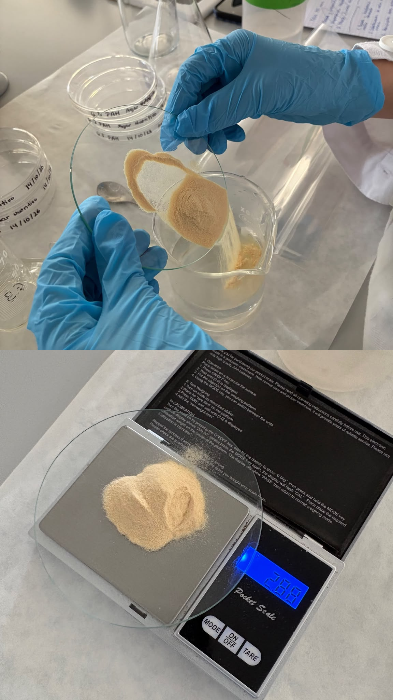
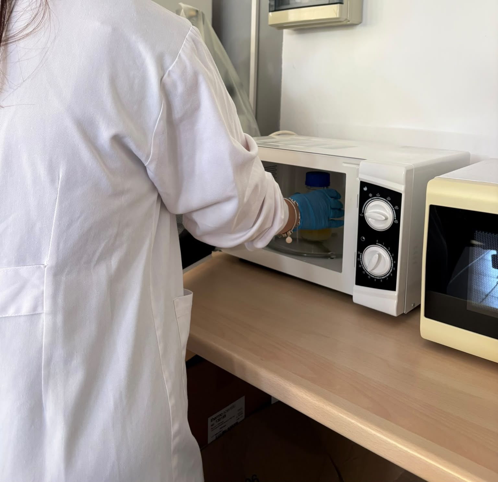
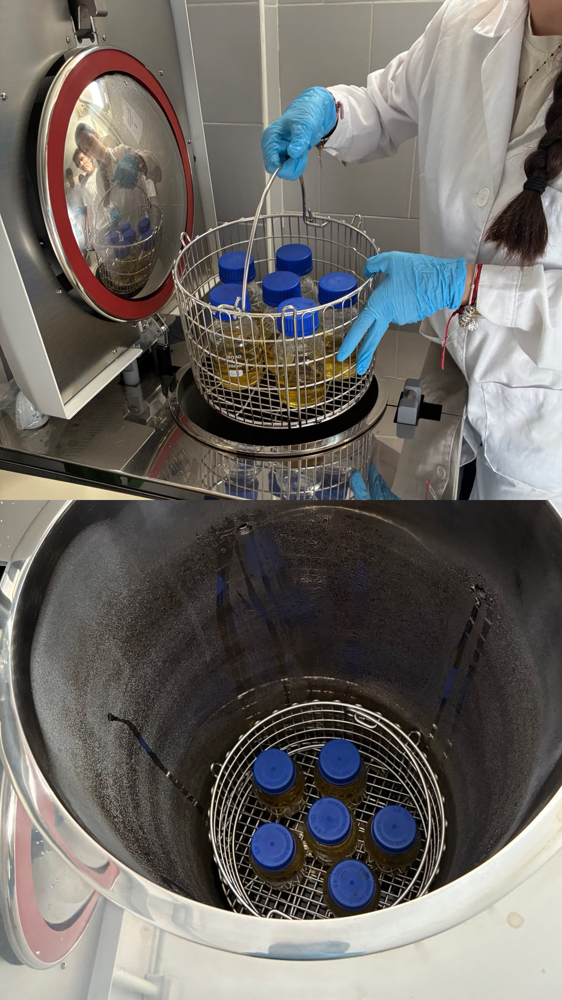
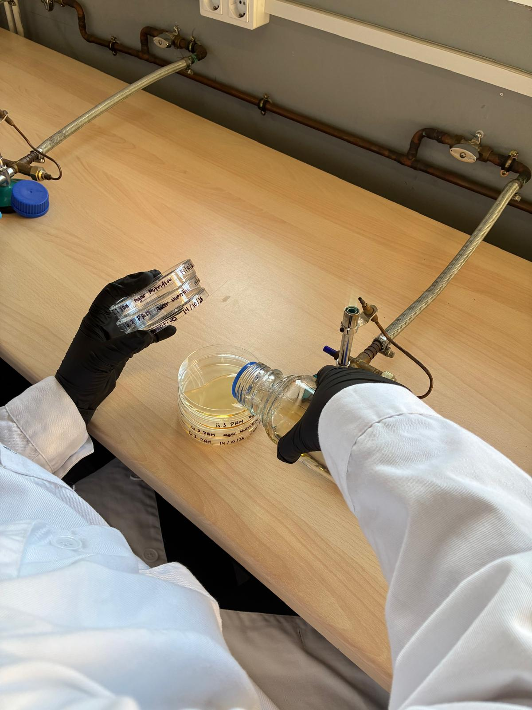
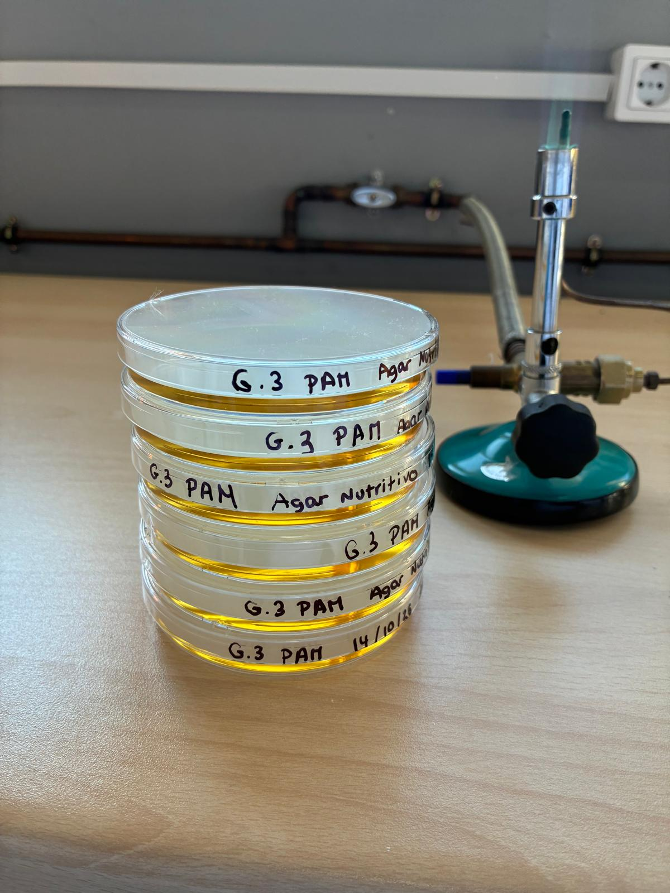

> Sube imágenes propias, pertinentes y tomadas de acuerdo con las normas del centro. No incluyas rostros, datos personales, etiquetas con información sensible ni material cuya fotografía esté prohibida. Si la evidencia procede de una demostración, de un registro docente o de placas ya preparadas, indícalo: no puede presentarse como ejecución propia.

### Imagen 1 — Pesada y transferencia del medio desecado

- **Pie de foto:** [Qué se observa: lectura de balanza, Agar nutritivo en polvo, vidrio de reloj o transferencia al recipiente]
- **Dato de trazabilidad o calidad que demuestra:** [Completa]
- **Autoría y origen:** [Propia / compartida con tu equipo / material docente autorizado]

### Imagen 2 — Calentamiento del medio tras la mezcla

- **Pie de foto:** [Recipiente con el medio mezclado durante el calentamiento hasta ebullición]
- **Control o decisión técnica que demuestra:** [Disolución del agar y desaparición de grumos; indica el equipo utilizado]
- **Autoría y origen:** [Ejecución propia / demostración docente / registro docente; especifica]

### Imagen 3 — Recipiente dentro del autoclave

- **Pie de foto:** [Botella o matraz autoclavable con el medio, colocado dentro del autoclave antes del ciclo]
- **Dato de trazabilidad o seguridad que demuestra:** [Identificación del recipiente y acondicionamiento para esterilización; no fotografíes el equipo abierto durante el ciclo]
- **Autoría y origen:** [Ejecución propia / demostración docente / registro docente; especifica]

### Imagen 4 — Dispensación aséptica en placas

- **Pie de foto:** [La imagen debe mostrar cómo se incorpora a las placas el medio tras su esterilización, de manera aséptica]
- **Zona autorizada y control aplicado:** [Cabina de seguridad biológica o entorno de la llama; explica la técnica aséptica observada]
- **Autoría y origen:** [Ejecución propia / demostración docente / registro docente; especifica]

### Imagen 5 — Placas finales etiquetadas o control de calidad

- **Pie de foto:** [Aspecto, grosor, rotulado o control de las placas]
- **Relación con el resultado principal:** [Explica cómo la evidencia respalda o limita tu conclusión]
- **Autoría y origen:** [Completa]

## 11. Incidencias, errores y medidas correctoras [ALUMNADO · RELLENABLE · DURANTE]

| Incidencia, error o duda detectada | Posible causa | Medida correctora aplicada o propuesta | ¿Afectó al resultado? |
|---|---|---|---|
| [Completa o escribe “No se detectaron incidencias”] | [Completa] | [Completa] | [Sí / No; explica] |

## 12. Interpretación técnica [ALUMNADO · RELLENABLE · DESPUÉS]

Interpreta si las placas obtenidas cumplen los criterios de fórmula, gelificación, homogeneidad, dispensación, identificación y control previstos. Explica qué evidencia sostiene esa valoración, qué resultado debe mantenerse pendiente hasta completar el control de esterilidad y por qué una placa aparentemente correcta no garantiza por sí sola su aptitud para uso posterior.

[Escribe aquí tu interpretación técnica.]

## 13. Conclusión [ALUMNADO · RELLENABLE · DESPUÉS]

¿En qué medida el procedimiento y el medio obtenido permiten considerar alcanzado el objetivo de preparar 125 mL de Agar nutritivo en placa? Justifica tu valoración relacionándola con el resultado y señala cualquier limitación que condicione su uso.

[Escribe aquí tu conclusión.]

## 14. Reflexión profesional [ALUMNADO · RELLENABLE · DESPUÉS]

Responde de forma razonada a las cuatro preguntas. Relaciona cada respuesta con cálculos, observaciones o imágenes incluidas en tu cuaderno.

1. **Procedimiento:** ¿Qué decisión sobre la fórmula, el agente gelificante o la dispensación consideras más crítica para obtener placas de calidad y cómo comprobaste que se realizó correctamente?

   [Respuesta del alumnado]

2. **Interpretación:** ¿Cómo interpretas la presencia de condensación excesiva en la tapa de las placas tras su solidificación, y qué impacto negativo puede tener en el momento de realizar una siembra por extensión o estría?

   [Respuesta del alumnado]

3. **Conclusiones:** ¿Qué datos mínimos de trazabilidad deben figurar obligatoriamente en el etiquetado de cada placa (o paquete de placas) para garantizar su correcta identificación y control de calidad a largo plazo?

   [Respuesta del alumnado]

4. **Aprendizaje y transferencia:** ¿De qué manera la destreza adquirida en el manejo estéril durante el vertido de placas influirá en la precisión de tus futuras técnicas de inoculación y siembra?

   [Respuesta del alumnado]

## 15. Trazabilidad y entrega [ALUMNADO · RELLENABLE · DESPUÉS]

| Campo | Registro del alumnado |
|---|---|
| Identificador de práctica | `P09` |
| Fecha | [dd/mm/aaaa] |
| UD / RA / CE | `UD3 / RA03 / CE03.a–CE03.h` |
| Agrupamiento | [Individual / equipo; especifica] |
| Medio, fórmula, volumen y número de placas | [Agar nutritivo comercial; fabricante/dosis según etiqueta; 125 mL objetivo; número real de placas] |
| Componentes, lotes y caducidades relevantes | [Producto en polvo, fabricante, lote, caducidad y dosis consultada] |
| Controles | [Resume o enlaza al apartado 9.1] |
| Resultado | [Resume o enlaza al apartado 9] |
| Interpretación | [Resume o enlaza al apartado 12] |
| Incidencias y acciones correctoras | [Resume o enlaza al apartado 11] |
| Ruta de residuos y conservación | [Según PNT local; completa modalidad y ubicación, sin inferir condiciones] |
| Estado de entrega | [Borrador / pendiente de revisión / entregado / corregido] |

---

## Referencias técnicas

- ISO. [ISO 11133:2014 — Microbiología de la cadena alimentaria. Preparación, producción, almacenamiento y ensayos de rendimiento de los medios de cultivo](https://www.iso.org/standard/53610.html). Referencia técnica general; consultar la edición y modificaciones vigentes y aplicar el PNT local.
- Protocolo docente adjunto: *P3 — Elaboración de medios de cultivo sólidos en placa*. Fuente de la escala de 125 mL (aprox. seis placas) y del inventario general de materiales. Sus recetas de componentes individuales no se aplican al medio comercial elegido.
