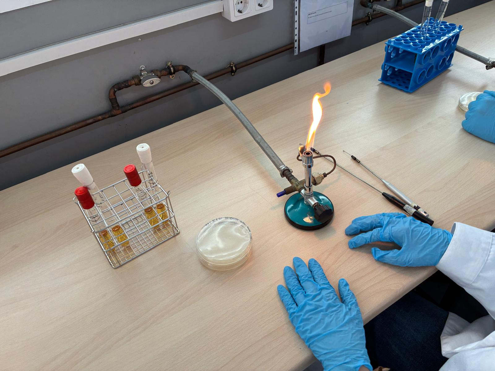
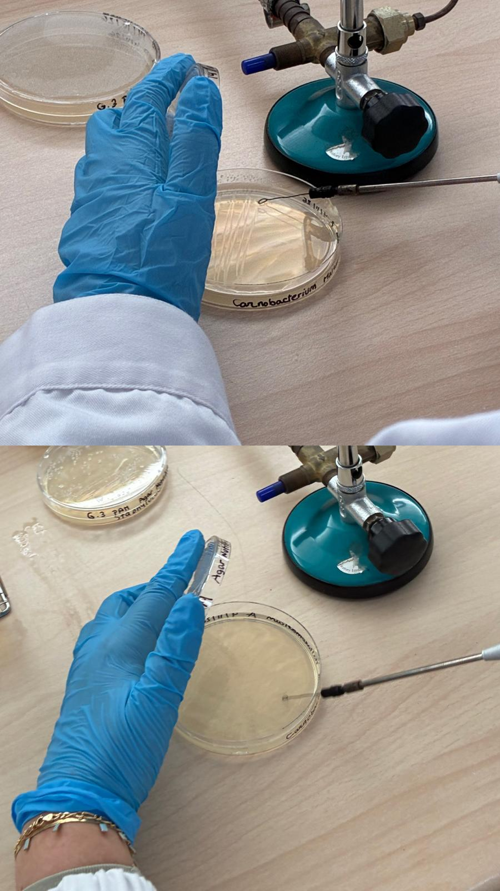
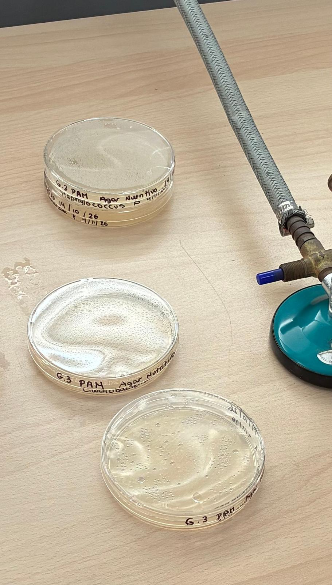

# P10 — Siembra en estría simple o continua

> **Estado de esta página:** Completa individualmente los bloques **[ALUMNADO · RELLENABLE]** durante la ejecución y durante la lectura posterior. La técnica puede realizarse por parejas cuando el centro lo organice, pero el registro, la descripción macroscópica, las imágenes seleccionadas y la reflexión deben ser personales.

## 1. Identificación de la práctica

| Campo | Información |
|---|---|
| Código y título | `P10 — Siembra en estría simple o continua` |
| Unidad didáctica | `UD3 — Bacteriología: técnicas de cultivo, aislamiento y recuento` |
| Resultado de aprendizaje | `RA04` |
| Criterios de evaluación | `CE04.a–CE04.e` |
| Aprendizaje transversal | `RA01 — bioseguridad` |
| Agrupamiento | Ejecución por parejas cuando proceda; registro y descripción macroscópica individual. |
| Instrumentos vinculados | Prueba práctica y cuaderno o portfolio de prácticas. |
| Modalidad prevista | Ejecución real supervisada con cultivo en medio líquido procedente de P08 y material autorizado. |

## 2. Resumen

En esta práctica sembrarás en una placa una alícuota del cultivo en medio líquido obtenido en P08, siguiendo la técnica de estría simple o continua. Mantendrás la trazabilidad entre ambas prácticas, aplicarás el procedimiento de manipulación aséptica del centro y registrarás el patrón de crecimiento tras la lectura autorizada. La siembra permite describir la distribución del crecimiento; por sí sola no confirma identidad ni pureza.

## 3. Finalidad y resultados esperados

La siembra en estría simple o continua es una técnica básica de inoculación. Su finalidad es aplicar una técnica aséptica, producir un patrón de crecimiento interpretable y describir macroscópicamente el resultado dentro de los límites del material docente autorizado.

Al finalizar deberás poder:

- preparar el puesto, el material y la placa de acuerdo con el protocolo;
- aplicar una secuencia de inoculación aséptica bajo supervisión;
- reconocer los puntos de control que reducen contaminación cruzada y aerosoles;
- describir el patrón de crecimiento observado en una placa segura o en una evidencia docente;
- diferenciar entre una observación macroscópica y una identificación definitiva; y
- registrar la técnica, la trazabilidad, las incidencias y el resultado de forma rigurosa.

## 4. Recursos, seguridad y autorización

**Recursos previstos:** cultivo de trabajo en medio líquido procedente de P08, placa con medio sólido, asa estéril desechable o reutilizable compatible con la ruta aprobada, gradilla si procede, EPI, desinfectante y recipientes de residuos del centro.

**Condición operativa:** se prevé ejecución real supervisada con el cultivo de trabajo procedente de P08, después de la subcultivación y los controles previstos en esa práctica. Antes de iniciar, el responsable confirmará la autorización del material y de la ruta, la supervisión, el equipo, el EPI y los residuos conforme al [PNT-010 del centro](#16-fuentes-tecnicas-y-documentales).

**Riesgos:** contacto con material biológico, generación de aerosoles, contaminación cruzada, derrame, corte o quemadura si el protocolo usa material que lo requiera, y gestión inadecuada de residuos.

**Medidas obligatorias:** usar el EPI indicado; preparar y desinfectar el puesto respetando el tiempo de contacto; trabajar por una sola ruta aprobada (banco con Bunsen o CSB II); mantener placa y tubo cerrados salvo durante la transferencia; evitar salpicaduras y aerosoles; y gestionar los residuos según el procedimiento local. En CSB no se utilizará llama abierta.

> **Aviso de seguridad.** Esta ficha está diseñada para una ejecución real supervisada. El docente comprobará antes de la sesión las condiciones locales requeridas por el [PNT-010](#16-fuentes-tecnicas-y-documentales). Si falta una condición crítica, no se manipulará el cultivo y la sesión quedará pendiente de autorización y reprogramación.

## 5. Fundamento técnico

La siembra en estría simple o continua transfiere un inóculo desde un medio líquido a la superficie de un medio sólido mediante un recorrido continuo en zigzag. La separación de las líneas y la cantidad de inóculo influyen en la distribución observada. La guía aportada describe líneas más próximas al inicio y más separadas al final para facilitar la observación de colonias.

La descripción macroscópica debe limitarse a lo realmente observable: presencia o ausencia de crecimiento, distribución, densidad relativa, aspecto general y posibles indicios de contaminación. No permite por sí sola identificar una especie ni confirmar pureza sin los controles y procedimientos correspondientes. La ausencia de crecimiento tampoco debe interpretarse automáticamente como un fallo técnico: debe revisarse la trazabilidad, el material y las condiciones del proceso.

## 6. Secuencia de trabajo y controles de calidad

### Secuencia general

1. Confirmar que el cultivo de trabajo de P08 completó la subcultivación y los controles previstos, además de las condiciones locales de autorización.
2. Preparar EPI, puesto, materiales y ruta autorizada conforme al [PNT-010 del centro](#16-fuentes-tecnicas-y-documentales).
3. Marcar la placa con la cepa o muestra, la fecha de inoculación y la persona o grupo responsable.
4. Transferir el inóculo y realizar la estría continua en zigzag, manteniendo la placa abierta el mínimo tiempo.
5. Cerrar, invertir y poner a incubar la placa según las condiciones de crecimiento autorizadas para la bacteria inoculada.
6. Registrar la trazabilidad, los controles, las incidencias y el patrón observado en la lectura autorizada.

### Procedimiento específico

**[PNT-010 de referencia](#16-fuentes-tecnicas-y-documentales):** Manipulación aséptica en bacteriología, v1.2. Sus apartados de preparación y manejo de placas/tubos fijan las comprobaciones previas y la ruta de trabajo. El centro confirmará la ruta y el equipo antes de ejecutar.

1. Confirma que el cultivo de trabajo de P08 completó la subcultivación y los controles previstos, y verifica trazabilidad, supervisión, ruta y recursos. Si falta una condición crítica, no inicies.
2. Comprueba la identificación e integridad del tubo y de la placa, y que el medio sólido está íntegro. Separa cualquier material dañado, con fuga o identificación dudosa y avisa al docente.
3. Colócate el EPI indicado. Marca la placa en el lateral o la zona inferior con la cepa o muestra, la fecha de inoculación y la persona o grupo responsable.
4. Desinfecta el puesto con el producto aprobado y respeta su tiempo de contacto; deja secar antes de iniciar.
5. Prepara el asa según la ruta autorizada: esteriliza en llama la reutilizable antes de inocular; en CSB II usa asa desechable o dispositivo eléctrico cerrado aprobado, nunca llama.
6. Homogeneiza suavemente el cultivo líquido de P08 según el procedimiento autorizado, evitando salpicaduras. Abre el tubo con la técnica del [PNT-010](#16-fuentes-tecnicas-y-documentales) correspondiente a la ruta elegida.
7. Toma el inóculo con el asa estéril sin tocar bordes ni superficies ajenas. Cierra el tubo conforme al [PNT-010](#16-fuentes-tecnicas-y-documentales) y devuélvelo a su gradilla.
8. Abre una sola placa lo mínimo necesario y deposita el inóculo en un extremo.
9. Traza las estrías de lado a lado en zigzag con el asa paralela al medio, sin tocar los bordes; sepáralas progresivamente hasta agotar el inóculo y evita perforar la superficie.
10. Cierra e invierte la placa; ponla a incubar en la estufa bajo las condiciones establecidas para el crecimiento de la bacteria inoculada, confirmadas por el docente.
11. Esteriliza en la llama el asa reutilizable únicamente en la ruta de banco autorizada; desecha el asa de un solo uso según la ruta local. En CSB II no uses llama. Limpia el puesto y comunica cualquier incidencia.

### Controles de calidad

- Origen y código de trazabilidad del cultivo líquido de P08 registrados.
- Autorización, supervisión, ruta y recursos comprobados antes de manipular.
- Placa marcada con la cepa o muestra, la fecha de inoculación y la persona o grupo responsable; tubo y medio íntegros; EPI y desinfección aplicados conforme al [PNT-010 del centro](#16-fuentes-tecnicas-y-documentales).
- Estría continua realizada sin perforar el agar ni cruzar líneas; modalidad real anotada.
- Placa invertida e incubada bajo las condiciones confirmadas para la bacteria inoculada; asa esterilizada o desechada según el tipo y la ruta autorizada.
- Lectura macroscópica autorizada descrita sin afirmar identidad ni pureza.
- Incidencias, posibles contaminaciones y decisiones de seguimiento documentadas.

---

# Tu cuaderno de prácticas

## 7. Datos de realización [ALUMNADO · RELLENABLE · DURANTE]

- **Nombre y apellidos:** Ariadna Seguro Ruiz
- **Fecha de ejecución:** 04/11/2026
- **Fecha de lectura, si procede:** [dd/mm/aaaa / pendiente / no aplicaba]
- **Grupo:** 2 LCB
- **Pareja de trabajo, si procede:** Miriam García y Paula Escobar
- **Rol o tarea principal que realizaste:** Preparación del material, siembra de 2 placas.
- **Modalidad realmente realizada:** Ejecución real supervisada; En pareja.
- **Código autorizado del cultivo de trabajo de P08 y de la placa:** [Completa sin incluir datos sensibles]

## 8. Preparación y análisis inicial [ALUMNADO · RELLENABLE · DURANTE]

### 8.1 Verificación previa

Enumera los recursos que vas a utilizar y los residuos previstos. Escribe «No aplica» cuando corresponda. Para cada residuo, selecciona uno de los tres tipos indicados; confirma su gestión según las instrucciones del centro.

| Elemento | Listado del alumnado |
|---|---|
| Instrumental | El instrumental que hemos utilizado ha sido: asa de siembra, gradilla, placas con medio sólido y cultivo en medio liquido de la P08 |
| Equipos |Hemos utilizado el mechero Bunsen|
| Reactivos/materiales | Papel de filtro para preparar el material antes de dirigirnos a los mecheros |

| Residuo previsto | Tipo |
|---|---|
| Guantes| Biológico (si ha entrado en contacto con el cultivo) si no es así es asimilable a lo urbano |

## 9. Observaciones y resultados [ALUMNADO · RELLENABLE · DURANTE]

### 9.1 Registro de observaciones y cálculos

Registra los datos de tu ejecución real y su relación trazable con P08. Escribe «No aplica» en cálculos o equipos cuando corresponda; no inventes datos que no estén disponibles.

| Aspecto | Registro del alumnado |
|---|---|
| Cálculos (si procede) | No procede |
| Configuración de equipos (si procede) | Se ha utilizado el mechero Bünsen. La llama debe estar azul (no naranja) y hay que tener cuidado con la fuente de gas |
| Características del producto o resultado final | Tras la incubación no se observó crecimiento |

## 10. Evidencias visuales [ALUMNADO · RELLENABLE · DURANTE Y DESPUÉS]

> Sube imágenes propias, pertinentes y tomadas de acuerdo con las normas del centro. No incluyas rostros, datos personales, etiquetas sensibles ni material biológico cuya fotografía o apertura esté prohibida. Identifica la fase de la ejecución real que muestra cada imagen.

### Imagen 1 — Preparación segura

- **Pie de foto:** Se observa el puesto de trabajo preparado en el banco con mechero Bunsen encendido, una gradilla metálica con cuatro tubos de cultivo en medio líquido, una placa de Petri cerrada con medio sólido, dos asas de siembra sobre la mesa y las manos del operario protegidas con EPI (guantes de nitrilo azules y bata blanca de laboratorio).
- **Control de seguridad o trazabilidad que demuestra:** Uso de EPI reglamentario (bata y guantes), empleo de ruta de trabajo en banco junto al mechero Bunsen y mantenimiento de los recipientes (placa y tubos) cerrados antes de iniciar la transferencia.
- **Autoría:** Compartida con pareja.

### Imagen 2 — Patrón de siembra

- **Pie de foto:** Montaje de dos fotografías durante la ejecución de la siembra en estría continua en zigzag sobre la superficie del agar utilizando el asa de siembra reutilizable junto al mechero Bunsen. Se observa la placa etiquetada en el lateral (donde se lee Carnobacterium y Agar Nutritivo) abierta parcialmente con una mano enguantada mientras se desliza el asa sobre el medio.
- **Decisión técnica asociada:** Apertura parcial y mínima de la placa junto a la zona de esterilidad del mechero Bunsen para evitar contaminaciones ambientales, trazando las estrías de lado a lado con el asa paralela a la superficie para no perforar el agar ni tocar los bordes.
- **Origen de la imagen:** Ejecución propia supervisada; Compartida con pareja.

### Imagen 3 — Lectura macroscópica

- **Pie de foto:** Tres placas de Petri cerradas e invertidas sobre el banco de trabajo junto al mechero Bunsen. Se distinguen las etiquetas manuscritas en los laterales con la identificación del grupo (G.3), el medio de cultivo (Agar Nutritivo), la cepa (Staphylococcus/Carnobacterium) y la fecha (04/11/2026). se aprecia condensación en el interior de las tapas y ausencia de colonias visibles (sin crecimiento) en el agar.
- **Relación con el resultado principal:** Tras la incubación no se observó crecimiento.
- **Autoría y origen:** Compartida con pareja.

## 11. Incidencias, errores y medidas correctoras [ALUMNADO · RELLENABLE · DURANTE Y DESPUÉS]

| Incidencia, error o duda detectada | Posible causa | Medida correctora, decisión de parada o escalado | ¿Afectó al resultado? |
|---|---|---|---|
| No se detectaron incidencias | No se observaron errores durante la preparación del material ni durante la siembra | No fue necesario aplicar medidas correctoras, ya que el procedimiento se realizó correctamente. | No. la práctica pudo desarrollarse con normalidad. |

## 12. Interpretación técnica [ALUMNADO · RELLENABLE · DESPUÉS]

Interpreta la calidad de la técnica y el patrón de crecimiento observado. Explica qué controles apoyan la lectura, qué incidencia podría explicar un resultado no esperado y por qué una descripción macroscópica no permite identificar de forma definitiva un microorganismo ni declarar pureza sin controles posteriores.

La siembra en estría simple continua se realizó para cultivar los microorganismos Staphylococcus y Carnobacterium en un medio sólido. La técnica consiste en extender el inóculo por la superficie del agar, manteniendo las condiciones de esterilidad. Los resultados se valorarán después de la incubación, observando si se produce crecimiento microbiano. Para identificar los microorganismos y comprobar la pureza del cultivo serían necesarias pruebas posteriores.

## 13. Conclusión [ALUMNADO · RELLENABLE · DESPUÉS]

Valora si alcanzaste el objetivo de realizar una siembra en estría simple o continua de forma segura. Relaciona razonadamente el objetivo con el procedimiento y el resultado registrado; identifica cualquier limitación o resultado pendiente.

El objetivo de realizar una siembra en estría simple se ha cumplido, ya que se ha extendido el inóculo sobre la superficie del medio de cultivo sólido, siguiendo el procedimiento adecuado y manteniendo las condiciones de esterilidad. La práctica ha permitido conocer y aplicar esta técnica de siembra para favorecer el crecimiento microbiano. No obstante, será necesario esperar a la incubación para valorar el crecimiento obtenido y comprobar los resultados.

## 14. Reflexión profesional [ALUMNADO · RELLENABLE · DESPUÉS]

Responde de forma razonada a las cuatro preguntas. Relaciona cada respuesta con registros, observaciones o imágenes incluidas en tu cuaderno.

**1. Procedimiento.** ¿Por qué es crítico el tiempo de enfriamiento del asa de siembra tras esterilizarla a la llama, y cómo te aseguraste de hacerlo correctamente sin comprometer la zona de esterilidad?

 El tiempo de enfriamiento del asa después de esterilizarla en la llama es fundamental porque, si se utiliza cuando todavía está caliente, puede quemar a los microorganismos del inóculo e impedir que crezcan. Se debe esperar unos segundos sin tocar ninguna superficie ni acercar el asa a materiales contaminados, manteniéndola dentro de la zona de trabajo estéril.

**2. Interpretación.** Si aparecen colonias con morfologías claramente distintas a lo largo de las estrías, ¿qué evidencia visual te ayudaría a discernir si el cultivo líquido original era mixto o si hubo una contaminación ambiental durante la apertura de la placa?

Si aparecen colonias con morfologías diferentes, por ejemplo con distinto tamaño, color, forma o textura, podría indicar que el cultivo líquido original tenía microorganismos. Sin embargo, si las colonias aparecen de forma individual y salteadas, especialmente en zonas lejos de las estrías, podría sospecharse una contaminación ambiental durante la apertura de la placa. Para diferenciarlos sería necesario comparar los resultados con los controles de calidad.

**3. Conclusiones.** Basándote en la presencia, cantidad y separación de las colonias aisladas, ¿qué puedes concluir de forma definitiva sobre la viabilidad y la concentración del cultivo líquido de partida?

Teniendo en cuenta que el cultivo líquido presentaba una ligera turbidez, pero no se observaban colonias aisladas, la turbidez podía indicar la presencia de microorganismos en suspensión. Si tras realizar la siembra aparecen colonias aisladas, se confirmaría que existían microorganismos viables capaces de crecer en el medio sólido. Sin embargo, la cantidad de colonias obtenidas no permite determinar la concentración inicial del cultivo.

**4. Aprendizaje y transferencia.** Si tuvieras que redactar el Procedimiento Normalizado de Trabajo (PNT) para enseñar esta siembra continua a un técnico recién contratado, ¿qué «vicio» procedimental o error de postura destacarías como el más urgente de prevenir desde el primer intento?

Uno de los errores más importantes que destacaría sería hacer demasiada presión con el asa sobre el medio de cultivo. Esto puede provocar rotura del agar, dañar el medio de cultivo y dificultar el aislamiento de las colonias. También hay que tener una postura adecuada y realizar movimientos suaves, evitando tocar los bordes de la placa y reducir lo máximo posible el tiempo que permanece abierta la placa para prevenir contaminaciones.

## 15. Trazabilidad y entrega [ALUMNADO · RELLENABLE · DESPUÉS]

| Campo | Registro del alumnado |
|---|---|
| Identificador de práctica | `P10` |
| Fecha de ejecución / lectura | 04/11/2026 |
| UD / RA / CE | `UD3 / RA04 / CE04.a–CE04.e` |
| Agrupamiento | Pareja; MIriam García y Paula Escobar |
| Modalidad y origen del material o evidencia | Práctica Real presencial. |
| Placa, medio y referencia autorizada | Placas de Petri con medio sólido Agar Nutritivo, inoculadas a partir del cultivo líquido procedente de la práctica P08 (Staphylococcus/Carnobacterium) identificadas con la referencia del grupo (G.3) y fecha 04/11/2026. |
| Controles | [Resume los controles aplicados y sus evidencias, si procede] |
| Resultado | [Resume o enlaza al apartado 9.1] |
| Interpretación | [Resume o enlaza al apartado 12] |
| Incidencias, medidas y escalado | [Resume o enlaza al apartado 11] |
| Ruta de residuos y estado final de la placa | [Completa] |
| Estado de entrega | [Borrador / pendiente de revisión / entregado / corregido] |

## 16. Fuentes técnicas y documentales

- Centro educativo. *PNT-010. Manipulación aséptica en bacteriología*. Versión 1.2, 27 de octubre de 2026. Documento interno consultado por el profesorado; aplicar la copia controlada vigente y las confirmaciones locales.
- *Prácticas de Microbiología Clínica: Siembra en estría simple o continua en medio sólido a partir de suspensión bacteriana en medio líquido*. Curso 2018–2019. PDF aportado por el profesorado.
- LaDonaBacteria. [«Práctica 6: Técnicas de siembra»](https://ladonabacteriablog.wordpress.com/2016/11/17/practica-6-tecnicas-de-siembra/), apartado «Siembra en estrías continuas o estrías simples». Consulta: 3 de noviembre de 2026.
- P08 — *Recuperación de liofilizados*, ficha del cuaderno de Microbiología Clínica; fuente del cultivo líquido y de su trazabilidad.

---
